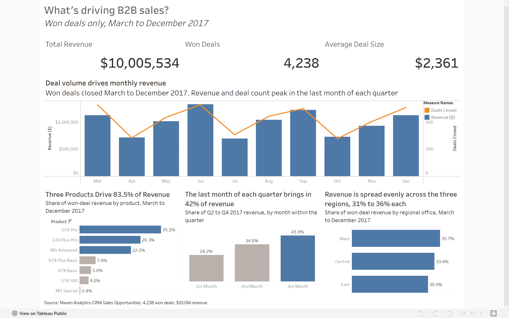

# Sales Performance Analysis: What's Driving Revenue?

An end-to-end analysis of B2B sales performance, using SQL, Python, and
Tableau to find out which products, customers, and sales
teams drive revenue, and how revenue has trended over time.

## Business Problem

A B2B company sells products to business accounts through a team of sales
agents organized under regional managers. Leadership can see total revenue,
but not what is behind it. Without knowing the drivers, it's hard to decide
where to invest, which products to push, or how to coach the sales team.

**This project answers one question: what's driving sales?**

To answer it, the analysis breaks revenue down into measurable pieces:

1. **Trend:** How has revenue changed over time?
2. **Products:** Which products and product series generate the most revenue?
3. **Customers:** Which account sectors and individual accounts contribute
   disproportionately to revenue?
4. **Sales team:** How do agents, managers, and regional offices compare?
5. **Volume vs. deal size:** Is revenue driven by winning more deals or by
   larger deals?

## Scope

- Revenue analysis uses **closed-won deals only**, since those carry
  realized revenue.
- Deals without dates are excluded from time-based analysis.
- Close dates run from March to December 2017, so trends are
  within-year only (no year-over-year comparison).

## Dataset

[Maven Analytics CRM Sales Opportunities](https://mavenanalytics.io/data-playground/crm-sales-opportunities): four related
tables (`accounts`, `products`, `sales_teams`, `sales_pipeline`) with
8,800 deals across 85 accounts, 7 products, and 35 sales agents on the roster (30 with pipeline activity). Of those,
4,238 deals were won, totaling $10,005,534 in revenue.

## Tools

- **SQL (DuckDB):** joins, aggregation, window functions, and growth calculations
- **Python:** scripts to load the data and run the SQL files
- **Tableau Public:** interactive dashboard

## Data Cleaning Decisions

| Issue | Finding | Decision |
|---|---|---|
| Revenue scope | Only Won deals have a close value (Lost = $0) | Revenue analysis uses Won deals only |
| Open and undated deals | 500 Prospecting deals have no dates or values, 1,589 Engaging deals have no close date or value | Excluded from revenue and trend analysis |
| Product name mismatch | `GTXPro` in pipeline (1,480 deals) vs `GTX Pro` in products | Standardized to `GTX Pro` |
| Sector typo | `technolgy` (12 accounts) | Corrected to `technology` |
| Country typo | `Philipines` (1 account) | Corrected to `Philippines` |
| Time span | Close dates run Mar to Dec 2017 | Within-year trends only, no year-over-year |
| Inactive agents | 5 of 35 agents on the roster have no deals in the pipeline | Left in the roster table, naturally excluded from agent-level analysis |
| Reconciliation | Cleaned `won_deals` view ties to raw Won totals (4,238 deals, $10,005,534) | Verified |

## Dashboard

[View the interactive dashboard on Tableau Public](https://public.tableau.com/app/profile/diego.ramirez7188/viz/Sales-Performance-Dashboard/WhatsdrivingB2Bsales)

## Key Findings

Won deals total **$10.0M across 4,238 deals** (average $2,361), closing March to December 2017.

1. **Product mix is the biggest driver.** Three products (GTX Pro, GTX Plus Pro, MG Advanced) generate 83.5% of revenue. The GTX series alone is about 73%.
2. **Discounting is not a factor.** Won deals close at 98.5% to 100.4% of list price for every product.
3. **Deal volume drives monthly swings.** Monthly revenue follows deal count (279 to 531 deals a month), while average deal size stays within $2,137 to $2,624.
4. **Revenue is back-loaded within each quarter.** In the three full quarters, the last month brings in 41.8% of quarterly revenue and the first month 24.2%.
5. **Win rate is flat.** It stays at 60% to 65% across products and 62% to 64% across managers, so conversion doesn't explain performance differences.
6. **Team performance reflects what each team sells.** One agent (Darcel Schlecht) produced 11.5% of revenue through high volume and a GTX Pro focus. One team has no GTX Pro deals in any stage, which explains its low average deal size ($1,465). All 15 GTK 500 wins ($400K) come from a single team.
7. **Regions are balanced.** West brings in 35.7% of revenue, Central 33.4%, and East 30.9%.
8. **Revenue is not concentrated in a few customers.** The top 10 accounts make up 20.7% of revenue, and the largest is 3.4%.

*Limitations:* the data covers one year (March to December 2017), so quarterly patterns rest on three complete quarters and aren't proof of seasonality. The analysis is observational, so it shows what correlates with revenue and doesn't prove cause.

## Recommendations

1. **Protect and grow the top three products.** They carry most of the revenue, so pipeline planning should start there.
2. **Review product assignment on the team with no GTX Pro deals.** Giving it access to the top-selling product is a low-risk test, though the data can't predict how well it would convert.
3. **Look at expanding GTK 500 beyond one team.** Each win is worth about $26,700, roughly 11 average deals, but only 25 deals closed, so treat it as a pilot.
4. **Build first-month pipeline.** The first month of each quarter is the weakest, and earlier-quarter activity could even out revenue.
5. **Skip price and conversion fixes for now.** Neither shows up as a driver in this data.